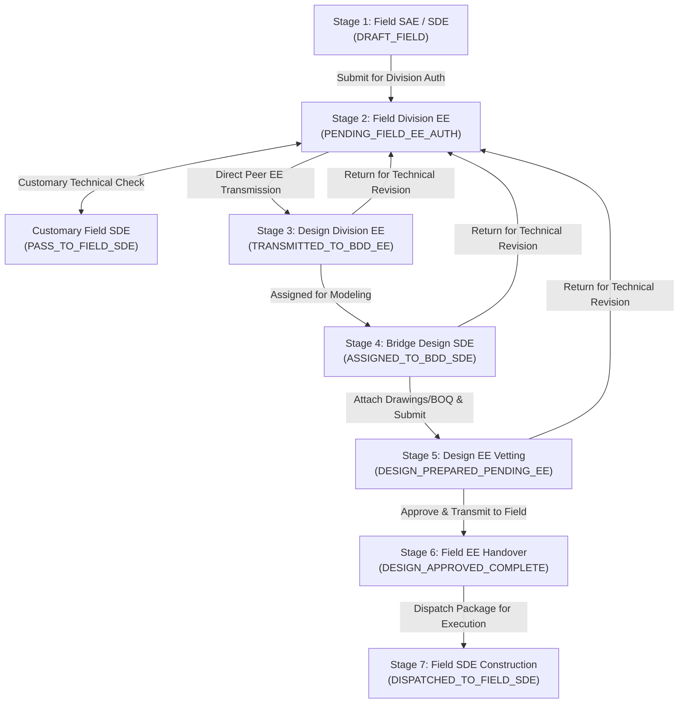
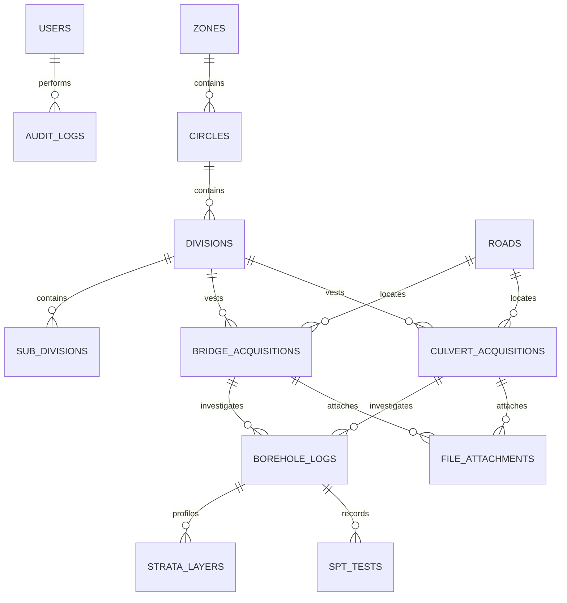

# RHD ADDS — System for Coordinated Exchange of Design Data
## Master Codebase Index & Architectural Catalog

> **Institutional Scope**: Roads and Highways Department (RHD), Ministry of Road Transport and Bridges, Government of the People's Republic of Bangladesh.  
> **System Purpose**: National web-based digital acquisition, multi-tier ministerial endorsement, geotechnical borelog synchronization, and design demand pipeline orchestration for all national bridge and culvert assets.  
> **Codebase Graph Index**: 1,610 Nodes • 5,758 Edges (Synchronized via `codebase-memory-mcp`)  
> **Index Timestamp**: 2026-11-06

---

## 1. Executive Summary & Tech Stack

| Layer | Technology | Key Libraries / Modules |
| :--- | :--- | :--- |
| **Backend API** | Python 3.10+ / FastAPI | Pydantic V2, SQLAlchemy ORM, Uvicorn, Python-Jose (JWT), ReportLab (PDF), OpenPyXL (Excel) |
| **Database** | SQLite (Dev/Fallback) / PostgreSQL | Relational schema with strict foreign keys, GIS coordinate bindings, JSON field strata storage |
| **Frontend UI** | React 19 / Vite | Tailwind CSS v4, Lucide React icons, Axios, Responsive Glassmorphic Engine |
| **GIS Integration** | RHD Live Webmap GIS | REST coordinate sync with `webmap.rhdbridge.com`, multi-layered GeoJSON layers |
| **Design Language** | Double-Beveled Glassmorphism | Specular highlights, radiant mesh gradients, frosted inputs, and tactile micro-interactions |

---

## 2. Directory Structure Map

```
D:\System 47\acqform/
├── backend/
│   ├── exports/                        # PDF, ZIP, and Excel compiled asset generation engines
│   │   ├── excel_exporter.py           # Multi-tab engineering schedule spreadsheet compiler
│   │   └── pdf_exporter.py             # Official RHD bilingual engineering datasheet PDF generator
│   ├── routers/                        # Modular FastAPI route controllers
│   │   ├── auth.py                     # Authentication, JWT sessions, demo role switching
│   │   ├── bridge.py                   # Bridge acquisition CRUD, transition gates, and validations
│   │   ├── culvert.py                  # Culvert acquisition CRUD, box geometry, and workflows
│   │   ├── exports.py                  # Datasheet, ZIP archive, and tabular schedule endpoints
│   │   ├── master.py                   # Administrative hierarchy (Zones, Circles, Divisions, Roads)
│   │   ├── pipeline.py                 # Design Demand Pipeline & bottleneck resolution tracking
│   │   ├── supreme.py                  # Supreme Authority governance, audit ledger, and resets
│   │   └── webmap.py                   # Borelog geometry and GIS synchronization endpoints
│   ├── uploads/                        # Persistent store for geotechnical reports, CAD drawings, photos
│   ├── auth.py                         # Password hashing, token encoding/decoding, RBAC guards
│   ├── config.py                       # App settings, environment variables, storage paths
│   ├── database.py                     # SQLAlchemy engine, session maker, DeclarativeBase
│   ├── jurisdiction.py                 # Road division bounding rules & automated administrative assignment
│   ├── main.py                         # FastAPI application entrypoint, CORS, exception handlers
│   ├── models.py                       # Core ORM database entities (Bridges, Culverts, Borelogs, Users)
│   ├── schemas.py                      # Pydantic V2 request/response validation schemas
│   ├── security.py                     # Cryptographic utilities and bearer authentication
│   ├── seed.py                         # Master institutional seed database script
│   └── workflow.py                     # 8-Tier finite state machine transition logic
├── frontend/
│   ├── src/
│   │   ├── components/
│   │   │   ├── borelog/                # Geotechnical Borehole Subsystem
│   │   │   │   ├── RhdWebmapBorelogForm.jsx  # Interactive SPT & strata management console
│   │   │   │   └── RhdWebmapBorelogForm.css  # Frosted glass geotechnical table styles
│   │   │   ├── bridge/                 # Bridge Acquisition Workspace
│   │   │   │   └── BridgeAcquisitionWorkspace.jsx # 6-phase engineering workspace (Canonical Base)
│   │   │   ├── culvert/                # Culvert Acquisition Workspace
│   │   │   │   └── CulvertAcquisitionWorkspace.jsx # 6-phase cross-drainage workspace in Dusky Plum
│   │   │   ├── dashboard/              # Role-Tailored Engineering Consoles
│   │   │   │   ├── EndorsementPipelineDashboard.jsx # Ministerial Circle/Zone/BMW routing console
│   │   │   │   ├── FieldDivisionDashboard.jsx       # Field SAE/SDE/EE preparation workbench
│   │   │   │   ├── ReviewerWorkbenchDashboard.jsx   # Bridge Design Circle scrutiny & sign-off
│   │   │   │   ├── SupremeOperationsConsole.jsx     # Omnipresent supervisor console
│   │   │   │   └── WebmasterConsole.jsx             # System configuration & telemetry console
│   │   │   ├── layout/                 # Shell & Chrome Elements
│   │   │   │   ├── TechnicalSidebar.jsx             # Collapsible navigation rail with hotkeys
│   │   │   │   └── TopCommandBar.jsx                # Glass header, role switcher & backdrop toggles
│   │   │   ├── pipeline/               # Design Demand Pipeline
│   │   │   │   └── DesignPipelineDashboard.jsx      # National demand ledger & bottleneck tracking
│   │   │   ├── registries/             # Technical Data Repositories
│   │   │   │   ├── BridgeRegistry.jsx               # Bridge registry with 4-card glass KPI strip
│   │   │   │   └── CulvertRegistry.jsx              # Culvert registry in Dusky Plum with 4-card KPI strip
│   │   │   └── workflow/               # Institutional Workflow Components
│   │   │       ├── AcquisitionProgressRibbon.jsx    # Real-time field completion ribbon
│   │   │       ├── ChainOfCommandStepper.jsx        # 7-stage Peer EE-to-EE visualizer
│   │   │       ├── PreparedDesignPackageCard.jsx    # CAD drawings, calc reports, and BOQ deliverables
│   │   │       ├── ReturnForCorrectionModal.jsx     # Scrutiny rejection & review note dialog
│   │   │       ├── UnifiedFlowPanel.jsx             # Combined workflow & navigation panel
│   │   │       └── UnifiedSideFlowPanel.jsx         # Sticky left sidebar status & completeness rail
│   │   ├── services/
│   │   │   └── api.js                  # Axios client, auth interceptors, and typed API services
│   │   ├── App.jsx                     # Root application coordinator and view router
│   │   ├── App.css                     # Component micro-animations and layout rules
│   │   ├── index.css                   # Master CSS, design tokens, glassmorphism, button styles
│   │   └── main.jsx                    # Vite React application entrypoint
│   └── index.html                      # HTML5 container with Bangladesh national typography fonts
├── sources/                            # Original government survey forms, schemas, and assets
├── start.py                            # Universal cross-platform launcher (Dev/Prod, auto-fallback)
├── start.bat                           # Windows batch execution launcher
├── start.sh                            # Linux/macOS/VPS bash launcher
└── INDEX.md                            # This Master Architecture & System Index
```

---

## 3. Peer EE-to-EE Workflow & Prepared Design Exchange Pipeline

Administrative relay layers (Circle SE, Zone ACE, BMW ACE, and BDC SE) have been abrogated. The workflow features direct peer exchange between Field Executive Engineers (`FIELD_EE`) and the vested Bridge Design Division Executive Engineers (`BDD_EE` 1, 2, or 3), with customary Sub-Divisional Engineer (`SDE`) verification and full bidirectional design deliverable package transfer:



### Institutional Role Hierarchy & Statutory Distribution

| Tier | Role Code | Designation | Primary Responsibilities |
| :---: | :--- | :--- | :--- |
| **0** | `SUPREME` | Supreme Authority | System-wide constitutional oversight, unconstrained overrides, audit inspection |
| **—** | `WEBMASTER` | Central Webmaster | User provisioning, role assignment, database seed management |
| **1** | `FIELD_SAE` | Field Sub-Assistant Engineer | Field data acquisition, site survey measurements, initial draft data entry |
| **2** | `FIELD_SDE` | Field Sub-Divisional Engineer | Customary field check (`PASS_TO_FIELD_SDE`) & site construction execution (`DISPATCHED_TO_FIELD_SDE`) |
| **3** | `FIELD_EE` | Field Executive Engineer | Division authentication, peer transmission to Design EE, and construction handover dispatch |
| **4** | `BDD_EE` | Design Division EE (Div-1/2/3) | Intake scrutiny lead, task assignment to Design SDE, vetting, and direct peer transmission back to Field EE |
| **5** | `BDD_SDE` | Bridge Design SDE | Structural analysis modeling, CAD drawing preparation, calculation reports, and itemized BOQ |

#### Statutory Distribution of Bridge Design Divisions
- **Bridge Design Division-1 (BDD-1)**: Vested with Dhaka, Mymensingh, and Rangpur Zones.
- **Bridge Design Division-2 (BDD-2)**: Vested with Sylhet, Cumilla, and Chattogram Zones.
- **Bridge Design Division-3 (BDD-3)**: Vested with Khulna, Barishal, Rajshahi, and Gopalganj Zones.

---

## 4. Backend Architecture & Route Index

All backend endpoints are housed under `/api` and defined in modular routers:

### 4.1. Core Application Files
* [**`backend/main.py`**](file:///D:/System%2047/acqform/backend/main.py): Initializes FastAPI, configures CORS for Vite frontend, sets up static file serving for uploads, runs automated database table migrations, and attaches routers.
* [**`backend/models.py`**](file:///D:/System%2047/acqform/backend/models.py): Defines 15+ SQLAlchemy ORM entities with foreign keys, enums, relationship cascades, and JSON storage for geotechnical strata and lab results.
* [**`backend/schemas.py`**](file:///D:/System%2047/acqform/backend/schemas.py): Pydantic V2 schemas ensuring strict type validation for dossier creation, updates, workflow transitions, and borelog synchronization.
* [**`backend/workflow.py`**](file:///D:/System%2047/acqform/backend/workflow.py): Pure functional workflow validation engine enforcing the transition table, role permissions, and return-for-correction rules.
* [**`backend/jurisdiction.py`**](file:///D:/System%2047/acqform/backend/jurisdiction.py): Automated geographical hierarchy lookup mapping chainages and GPS coordinates to the authentic RHD Zone, Circle, Division, and Sub-Division.

### 4.2. API Routers Summary

| Router | File Path | Endpoint Prefix | Key Capabilities |
| :--- | :--- | :--- | :--- |
| **Bridges** | [`backend/routers/bridge.py`](file:///D:/System%2047/acqform/backend/routers/bridge.py) | `/api/acquisitions/bridge` | Full CRUD, Phase 1–6 field updates, 8-tier transitions, audit logs, file uploads |
| **Culverts** | [`backend/routers/culvert.py`](file:///D:/System%2047/acqform/backend/routers/culvert.py) | `/api/acquisitions/culvert` | Box culvert CRUD, hydraulic parameters, vent geometries, workflow transitions |
| **Pipeline** | [`backend/routers/pipeline.py`](file:///D:/System%2047/acqform/backend/routers/pipeline.py) | `/api/pipeline` | Design demand backlog, running/suspended status, 8 bottleneck presets, KPI counts |
| **Master Data** | [`backend/routers/master.py`](file:///D:/System%2047/acqform/backend/routers/master.py) | `/api/master` | Hierarchical zones, circles, divisions, roads, proposed bridge types, navigation classes |
| **Webmap Sync** | [`backend/routers/webmap.py`](file:///D:/System%2047/acqform/backend/routers/webmap.py) | `/api/webmap` | GeoJSON structure feeds, borehole GPS sync, live map coordinate validation |
| **Exports** | [`backend/routers/exports.py`](file:///D:/System%2047/acqform/backend/routers/exports.py) | `/api/acquisitions/{type}/{id}/export-*` | Formatted PDF datasheet, tabular Excel schedule, and complete ZIP archive dossier |
| **Supreme** | [`backend/routers/supreme.py`](file:///D:/System%2047/acqform/backend/routers/supreme.py) | `/api/supreme` | Complete database reset, mock dossier generator, emergency workflow reassignments |
| **Auth** | [`backend/routers/auth.py`](file:///D:/System%2047/acqform/backend/routers/auth.py) | `/api/auth` | JWT issuance, password verification, demo role-switching utility |

---

## 5. Frontend Architecture & Component Catalog

The frontend is a single-page application built on React 19 and Vite with zero external CDN dependencies.

### 5.1. Core Application Shell
* [**`frontend/src/App.jsx`**](file:///D:/System%2047/acqform/frontend/src/App.jsx): Root orchestrator managing session state, role switches, active views (`dashboard`, `bridges`, `culverts`, `new_bridge`, `new_culvert`, `pipeline`, `webmaster`, `supreme`), global shortcut listeners (`Ctrl+B`), and ambient background modes.
* [**`frontend/src/components/layout/TopCommandBar.jsx`**](file:///D:/System%2047/acqform/frontend/src/components/layout/TopCommandBar.jsx): Glassmorphic command header with authentic high-resolution RHD logo, fast role switcher, live GIS webmap link, and backdrop mode selector (*Gradient*, *Photo*, *Blend*).
* [**`frontend/src/components/layout/TechnicalSidebar.jsx`**](file:///D:/System%2047/acqform/frontend/src/components/layout/TechnicalSidebar.jsx): Collapsible left navigation rail with smooth transition easing, keyboard shortcut hints, and user identity card.

### 5.2. Acquisition Workspaces
* [**`BridgeAcquisitionWorkspace.jsx`**](file:///D:/System%2047/acqform/frontend/src/components/bridge/BridgeAcquisitionWorkspace.jsx) *(Canonical Base)*:
  * **Phase 1**: Administrative & Location Identification (Zones, Divisions, Road ID, River channel width)
  * **Phase 2**: Navigation & Existing Structure (BIWTA/Railway vertical/horizontal clearances, existing bridge datum)
  * **Phase 3**: Hydrological Data & Water Levels (HFL, SHWL, LWL, HTL/LTL, survey history)
  * **Phase 4**: Proposed Structure Geometry (Alignment, total length, span arrangement, pier protection)
  * **Phase 5**: Soil Investigation & Drawing Attachments (EE-signed soil report, L-sections, cross-sections)
  * **Phase 6**: Geotechnical Borehole Subsystem (SPT N-values, strata layers, soil mechanics)
  * **Controls**: `CircleChevronLeft` back button, left vertical tab rail (`Alt+1..6`), double-beveled glass cards, transparent inputs, and persistent bottom command strip.
* [**`CulvertAcquisitionWorkspace.jsx`**](file:///D:/System%2047/acqform/frontend/src/components/culvert/CulvertAcquisitionWorkspace.jsx):
  * Identical geometry, structure, and responsive behaviors to the bridge workspace.
  * Styled in **Elegant Dusky Heather Plum** (`#8e4b7b`) discipline identity.
  * Form inputs calibrated for cross-drainage, box culverts, pipe culverts, vent dimensions, and haor/flash-flood hydraulic parameters.

### 5.3. Technical Registries
* [**`BridgeRegistry.jsx`**](file:///D:/System%2047/acqform/frontend/src/components/registries/BridgeRegistry.jsx):
  * 4-Card Frosted Glass Metric Strip: Total Registered, Active Drafts, Awaiting Authorization, Approved Complete.
  * Live filter by stage and instant code/name/road search.
  * Dense technical table with frosted status badges and rounded action buttons (`View`, `PDF`, `ZIP`, `Excel`, `Webmap`).
* [**`CulvertRegistry.jsx`**](file:///D:/System%2047/acqform/frontend/src/components/registries/CulvertRegistry.jsx):
  * Symmetrical 4-card metric strip with plum accent highlights.
  * Specialized culvert columns: Proposed Span & Barrel Size, Vent counts, Borehole tallies.

### 5.4. Geotechnical & Borelog Engine
* [**`RhdWebmapBorelogForm.jsx`**](file:///D:/System%2047/acqform/frontend/src/components/borelog/RhdWebmapBorelogForm.jsx):
  * Dynamic borehole switcher (BH-01, BH-02, ... up to 40 boreholes).
  * Dynamic USCS Strata layering table with depth top/bottom tracking.
  * Standard Penetration Test (SPT) blow count matrix ($N_1, N_2, N_3 \implies N$-value computation).
  * Direct synchronization engine with `webmap.rhdbridge.com` GIS database.

### 5.5. Workflows, Dashboards & Panels
* [**`UnifiedSideFlowPanel.jsx`**](file:///D:/System%2047/acqform/frontend/src/components/workflow/UnifiedSideFlowPanel.jsx): Sticky left panel merging the 8-tier stage visualizer, completion percentage meter, and phase tab buttons.
* [**`DesignPipelineDashboard.jsx`**](file:///D:/System%2047/acqform/frontend/src/components/pipeline/DesignPipelineDashboard.jsx): National backlog tracker featuring running/suspended states, division assignment, and 8 bottleneck presets.
* [**`FieldDivisionDashboard.jsx`**](file:///D:/System%2047/acqform/frontend/src/components/dashboard/FieldDivisionDashboard.jsx): SAE/SDE/EE field cockpit with draft lists, awaiting EE queues, and returned dossier alert banners.
* [**`EndorsementPipelineDashboard.jsx`**](file:///D:/System%2047/acqform/frontend/src/components/dashboard/EndorsementPipelineDashboard.jsx): Ministerial review console for SE, ACE, and BMW leadership.
* [**`ReviewerWorkbenchDashboard.jsx`**](file:///D:/System%2047/acqform/frontend/src/components/dashboard/ReviewerWorkbenchDashboard.jsx): Bridge Design Circle scrutiny cockpit with Approve and Return-for-Correction modal triggers.

---

## 6. Design System & Glassmorphism Specifications

The visual interface implements a high-precision frosted glass aesthetic with double-beveled borders, specular light diffusion, and WCAG AAA compliant text contrast.

### 6.1. Official Palette Tokens

| Token Name | Hex Code | Semantic Role |
| :--- | :--- | :--- |
| `--c-navy` | `#00225a` | Primary institutional brand, titles, high-emphasis text |
| `--c-midnight` | `#001139` | Deepest high-contrast display text and form input values |
| `--c-cobalt` | `#034081` | Action buttons, active badges, primary icons |
| `--c-azure` | `#429afe` | Focus rings, intermediate stage indicators, active tab borders |
| `--c-cyan` | `#01c1f2` | GIS webmap buttons, geotechnical accents, gradient start |
| `--c-emerald` | `#15db7c` | Approved complete status, success toasts, progress meters |
| `--c-plum-primary` | `#8e4b7b` | Culvert acquisition discipline accent, culvert tab active state |
| `--c-plum-deep` | `#7a3869` | Culvert action buttons, dossier code links, pill badges |
| `--c-plum-text` | `#4a1e46` | High-contrast culvert typography |
| `--c-amber` | `#e95a24` | Review bottlenecks, scrutiny returns, high-priority alerts |

### 6.2. Ambient Canvas Backdrop Modes
Managed via [`App.jsx`](file:///D:/System%2047/acqform/frontend/src/App.jsx#L165-L178) and configurable via [`TopCommandBar.jsx`](file:///D:/System%2047/acqform/frontend/src/components/layout/TopCommandBar.jsx#L88-L127):
1. **Gradient**: Radiant 90-degree cyan-to-azure-to-emerald linear gradient with animated floating ambient orbs.
2. **Photo**: Authentic high-resolution RHD engineering bridge drafting desk photograph with soft ambient vignette.
3. **Blend**: Studio blend layering the structural drafting photograph directly under the radiant mesh gradient.

---

## 7. Database Entities & Schema Architecture



### Key Schema Characteristics
* **`BridgeAcquisition` (`backend/models.py`)**: Stores 70+ engineering attributes covering navigation clearances, design water levels, foundation type, carriageway width, pier protections, and current workflow holder role.
* **`CulvertAcquisition` (`backend/models.py`)**: Stores 50+ attributes specialized for cross-drainage, hydraulic discharge, barrel length, vent count, scour depth, and existing slab/wall conditions.
* **`BoreholeLog` (`backend/models.py`)**: Stores borehole numbers, chainages, RL ground elevations, water table depths, GPS lat/lng, and serialized JSON arrays for strata, SPT blow counts, and lab test results.

---

## 8. Verification & Operational Health

* **Frontend Build**: Fast, modular bundling via Rolldown/Vite with zero external dependencies. Verified via `npm --prefix frontend run build` (compiles cleanly in < 1 second).
* **Codebase Graph Synchronized**: Persistent index artifact saved in `.codebase-memory/graph.db.zst` containing complete symbol references, route calls, and dependency links.
* **Cross-Repo Linkage**: Automated geospatial coordinate alignment with `D:\System 47\Webmap` (`webmap.rhdbridge.com`).
